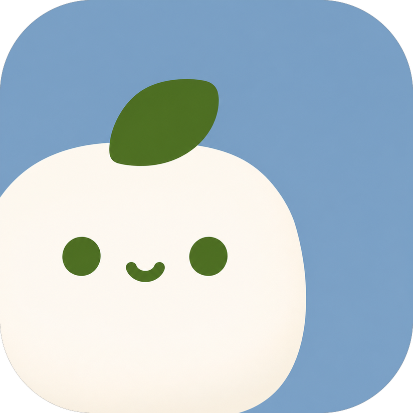
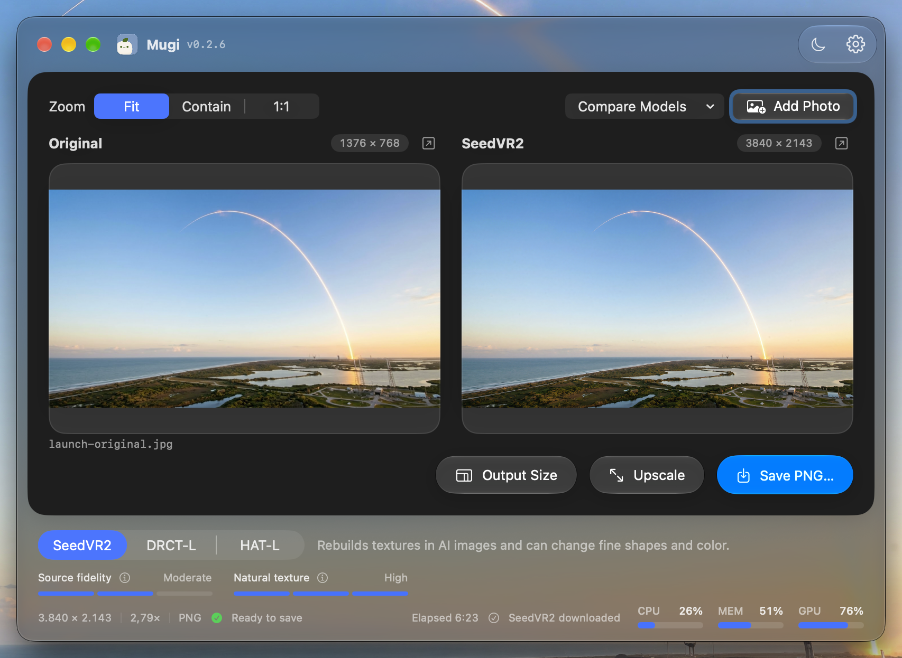
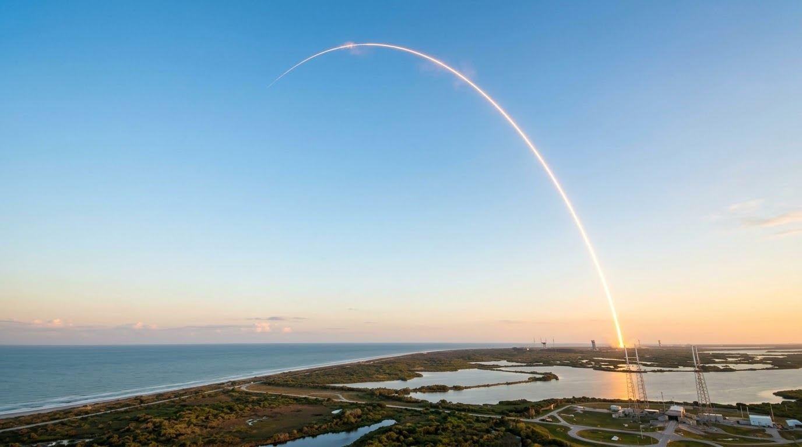
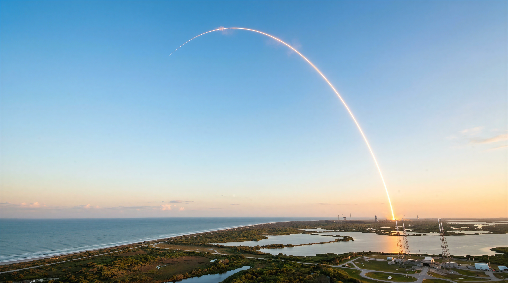
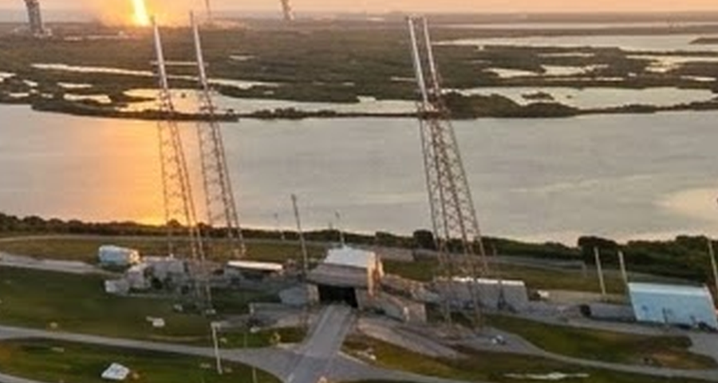
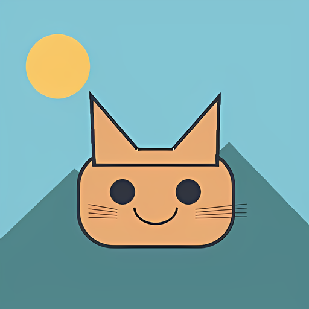

<div align="center">



# Mugi

Local AI image upscaler for macOS. Enlarge photos and AI-generated images to 4K, 8K, or a custom size on your Apple Silicon Mac.

**[Download Mugi for Apple Silicon](https://github.com/absolutepraya/mugi-upscale/releases/latest)**

[](https://github.com/absolutepraya/mugi-upscale/actions)


[](LICENSE)

[Preview](#preview) • [Features](#features) • [Install](#install) • [Use the app](#use-the-app) • [Command line](#command-line) • [Models](#models) • [Build a DMG](#build-a-dmg)

</div>

Mugi includes a native SwiftUI app and a command line tool. Choose SeedVR2 to reconstruct texture, Anime 6B for cleaner anime and cartoons, DRCT-L for clean graphics, or HAT-L for soft or compressed photos. Each model runs locally through Metal after its weights are available.

## Preview



Mugi in Dark mode with Glass set to 80%. The frosted frame lets the wallpaper or window behind it show through. Adjust Glass in **Settings → General**.

### Before and after with SeedVR2

Select either image to open it at full size. The 4K example is a WebP copy of the exported PNG.

| Original JPEG · 1,376 × 768                                                                                                                | SeedVR2 · 3,840 × 2,143                                                                                                          |
| ------------------------------------------------------------------------------------------------------------------------------------------ | -------------------------------------------------------------------------------------------------------------------------------- |
| [](assets/examples/launch-original.jpg) | [](assets/examples/launch-seedvr2-4k.webp) |

The close-ups use the same framing around the launch site. The original is enlarged to match.

| Original detail                                                                                              | SeedVR2 detail                                                                                                           |
| ------------------------------------------------------------------------------------------------------------ | ------------------------------------------------------------------------------------------------------------------------ |
|  |  |

### Before and after with Anime 6B

Anime 6B at 2× on a lightly compressed cartoon JPEG. Compare the outlines around the ears and the fine whisker lines. Select either image to open it at full size.

| Original JPEG (256 × 256)                                                                                                                           | Anime 6B (512 × 512)                                                                                                              |
| --------------------------------------------------------------------------------------------------------------------------------------------------- | --------------------------------------------------------------------------------------------------------------------------------- |
| [](assets/examples/cartoon-original.jpg) | [](assets/examples/cartoon-anime-6b-2x.png) |

## Features

- **Local processing.** The DMG bundles Python and three models. Select SeedVR2 and click **Download** to get its weights (about 4 GB).
- **Model guidance.** See what each model is best for, then compare how it handles details, outlines, and compression.
- **Compare models.** Choose any two models and view their results side by side before you save one.
- **Inspect at 1:1.** Pan and zoom both panes together to check fine detail.
- **Your format.** Exports 8-bit sRGB PNG by default, or JPEG, TIFF, or HEIC, with ICC profiles and EXIF orientation handled for you.
- **Auto-save.** Optionally save every result to a folder you choose as soon as it is ready.
- **Wide input support.** Accepts PNG, JPEG, WebP, and TIFF.

## Install

You'll need an Apple Silicon Mac with macOS 14 or newer.

### From a DMG

1. Download the Apple Silicon DMG from the [latest GitHub release](https://github.com/absolutepraya/mugi-upscale/releases/latest).
2. Open it and drag **Mugi.app** into **Applications**.

> [!IMPORTANT]
> The app uses ad-hoc signing. If macOS blocks it, follow the [installation guide](packaging/INSTALL.md), which is also inside the disk image.

### From source

You'll also need Swift 6 with a macOS SDK from Xcode or the Command Line Tools (`xcode-select --install`), and [`uv`](https://docs.astral.sh/uv/getting-started/installation/).

```sh
git clone https://github.com/absolutepraya/mugi-upscale.git
cd mugi-upscale
./setup.sh
./build-app.sh
open "build/Mugi Dev.app"
```

Setup creates a local Python environment, downloads the SeedVR2 runtime source, and verifies the bundled model weights (about 406 MiB in total).

> [!NOTE]
> Keep the built app in the repository's `build/` directory so it can find the environment and model weights. Rebuild with `./build-app.sh` after editing the Swift source.

> [!NOTE]
> A source build is **Mugi Dev**, with its own bundle ID, settings, and SeedVR2 cache, so it can sit next to an installed **Mugi** without touching it. `./build-app.sh --release` builds the production identity that the DMG uses. To reuse SeedVR2 weights you already downloaded without using extra disk, clone the folder: `cp -Rc ~/Library/Caches/dev.abhipraya.local-upscaler ~/Library/Caches/dev.abhipraya.local-upscaler.dev`.

## Use the app

1. Click **Add Photo** (⌘O) at the top right of the preview area, or drop a photo onto the window.
2. Select a model using its **Best for** tip. **Source fidelity** covers shapes, colors, and lettering. **Natural texture** applies to photos. **Line preservation** describes how well fine strokes keep their shape. **Compression cleanup** describes how well the model reduces blocks and halos while keeping detail. Hover over or click an info button for an explanation. The bars are guides and results vary with the image. If SeedVR2 is missing, click **Download** next to its bars. The status row shows download speed and progress, and you can pause and resume.
3. Optionally click **Output Size** to set the size for this photo. Size it by **Scale** (such as 2×), **Long edge**, **Width**, or **Height**, up to 8,192 px, or pick a preset. Mugi keeps the original aspect ratio. The default comes from Settings.
4. Click **Upscale**. A progress bar appears at the left of the buttons. The timer includes model loading and PNG preparation. SeedVR2 shows its processing stage and may take several minutes. If the chosen size is not larger than the photo, the button reads **Resize** and Mugi resizes it without a model.
5. When the second preview appears, click **Save…**, or turn on auto-save in Settings.

The bottom right shows live CPU, memory, and GPU gauges. Hover one for details such as busy cores or GB in use.

The icon buttons in the title bar switch between System, Light, and Dark appearance and open **Settings** (⌘,).

- **General:** appearance, the **Glass** slider (how see-through the window is, from a solid window color at 0% to full frosted glass at 100%), default model with its use-case tip and quality bars, default output size (by scale, long edge, width, or height), tile size under Advanced, the system stats gauges (show or hide them, and show percentages, used / total, or no value text), haptic feedback, and a reset for all settings.
- **Models:** check model availability, reveal model files in Finder, and download or delete SeedVR2. DRCT-L, HAT-L, and Anime 6B are included with Mugi.
- **Output:** auto-save, the default output folder, and the image format, with a quality slider for JPEG and HEIC.
- **About:** the version, updates (see below), credits, source code, and model licenses.

### Updates

Mugi checks GitHub for a newer release when it opens, at most once a day. When one exists, an **Update** button appears beside the version in the title bar. Click it to read the release notes, then **Update and Restart**. Mugi downloads the new version, checks it against the release's SHA-256 checksum, replaces itself, and relaunches. It never installs or restarts on its own, and the button waits while an upscale is running. If a step fails, your installed copy is left as it was.

In **Settings > About** you can check now, see when Mugi last checked, and turn off the automatic check. If Mugi is running from a disk image or a folder it cannot write to, the button opens the release page instead. Development builds ("Mugi Dev") never check for updates.

Click the arrow button beside a preview's size to open that image in its own larger window. It is resizable, and Esc closes it.

Use **1:1** to inspect the output at one image pixel per display pixel. Drag either pane to pan both together. The original scales to the same framing as the output. **Fit** shows the whole image, and **Contain** shows the whole image at up to 1:1.

Click **Compare Models** and choose a pair. Mugi runs any missing model first and keeps the results for the current image. Use **Show Original** to switch back, or **Save…** to choose which output to export.

## Command line

The same engine is available from the terminal. Run these from the repository with `uv` installed.

```sh
# One photo
uv run --locked upscale.py "/path/to/landscape.png" -o output/landscape-4k.png

# A whole folder
uv run --locked upscale.py input -o output

# A soft or compressed photo
uv run --locked upscale.py "/path/to/landscape.png" --model hat -o output/landscape-hat-4k.png

# A generated image
uv run --locked upscale.py "/path/to/generated.png" --model seedvr2 -o output/generated-seedvr2-4k.png

# Anime or a cartoon
uv run --locked upscale.py "/path/to/art.png" --model anime -o output/art-anime-4k.png
```

| Option        | Default | What it does                                                                                                                      |
| ------------- | ------- | --------------------------------------------------------------------------------------------------------------------------------- |
| `--model`     | `drct`  | `drct` for clean graphics, `hat` for compression and blur, `seedvr2` for natural textures, or `anime` for anime and cartoons      |
| `--long-edge` | `3840`  | Target size of the long edge in pixels. A 16:9 input becomes 3840 × 2160. Use `4096` for a 4,096-pixel long edge                  |
| `--tile`      | `256`   | DRCT-L, HAT-L, and Anime 6B input tile size: `128`, `192`, `256`, `320`, or `384`. Use `192` or `128` if Metal runs out of memory |
| `--device`    | `mps`   | `mps` runs on the GPU through Metal. DRCT-L, HAT-L, and Anime 6B also support `cpu`                                               |

Other aspect ratios keep their framing. The CLI refuses to overwrite an existing output path, so use a new filename or directory to rerun.

> [!TIP]
> Compare foliage, fog, fine edges, and repeating textures at 100% zoom. SeedVR2 can introduce new detail and change the color or shape of fine features.

## Develop

Formatting uses [Oxfmt](https://oxc.rs/docs/guide/usage/formatter) and linting uses [Oxlint](https://oxc.rs/docs/guide/usage/linter). Install them with `pnpm install`, then run the fast checks CI runs:

```sh
pnpm run check        # format check, lint, script syntax, lockfile check, unit tests (about a second)
pnpm run lint:shell   # shellcheck on the shell scripts (needs shellcheck installed)
pnpm run fmt          # apply formatting
pnpm run test:manual  # real upscale of a tiny image with a model; local only, never in CI
```

CI runs the same checks, then builds both app variants. The manual test needs the environment and weights from `./setup.sh`. Set `MODEL=hat`, `MODEL=seedvr2`, or `MODEL=anime` to try another model. New worktrees created in T3 Code set themselves up through [`t3.json`](t3.json). See [`AGENTS.md`](AGENTS.md) for the project conventions that contributors and coding agents follow.

## How it works

DRCT-L, HAT-L, and Anime 6B use [Spandrel](https://github.com/chaiNNer-org/spandrel) and run a native 4× pass on overlapping tiles. SeedVR2 runs a diffusion pass at a working resolution based on the requested size, aspect ratio, and unified memory. The working resolution is capped at about 4K on a Mac with 24 GB of memory and lower on Macs with less memory. Mugi uses Lanczos to reach the requested dimensions, including 8K. If the source already meets the model's working size, Mugi resizes it directly.

Run one job at a time so the GPU has room for the tiles.

## Models

Setup downloads these weights from Philip Hofmann's model repositories under [CC BY 4.0](https://creativecommons.org/licenses/by/4.0/):

- DRCT-L: [4xNomos2_hq_drct-l](https://huggingface.co/Phips/4xNomos2_hq_drct-l)
- HAT-L: [4xNomos8kSCHAT-L](https://huggingface.co/Phips/4xNomos8kSCHAT-L)

Anime 6B uses the [Real-ESRGAN anime checkpoint](https://github.com/xinntao/Real-ESRGAN/blob/master/docs/anime_model.md) by Xintao Wang and contributors. See the [upstream BSD 3-Clause license](packaging/REAL-ESRGAN-LICENSE.txt). Start near 2× for cleaner anime and cartoons. On tiny or heavily compressed inputs, check for broken outlines, lost strokes, or reshaped features at 1:1. For clean logos or fine hatch lines, start with DRCT-L.

SeedVR2 uses the [upstream CLI integration](https://github.com/numz/ComfyUI-SeedVR2_VideoUpscaler/tree/4490bd1f482e026674543386bb2a4d176da245b9) and the 3B Q8 model. Its weights are verified on download and cached in `~/Library/Caches/dev.abhipraya.local-upscaler/SeedVR2`.

The application and CLI source are under the [PolyForm Noncommercial License 1.0.0](LICENSE). See [License](#license) below. The third-party models and the SeedVR2 runtime keep their own licenses.

## Build a DMG

On an Apple Silicon Mac with `uv` and the Apple developer tools:

```sh
./packaging/build-dmg.sh 0.1.0
```

The DMG appears under `build/dist/`. It contains the app, Python, its locked dependencies, and the DRCT-L, HAT-L, and Anime 6B weights. Use **Download** in the app to install SeedVR2.

The [CI workflow](.github/workflows/ci.yml) runs the fast checks, then builds the app, on pull requests and pushes to `main`. To publish a release, start the [macOS Release workflow](.github/workflows/macos-release.yml) from `main` with a new version such as `0.1.0`. It builds the DMG and publishes a release named `Mugi <version>` with the DMG, a SHA-256 checksum, the install instructions, and notes generated from the merged pull requests. It refuses to run if that version's release already exists.

## License

Mugi is **source-available**, not open source. It is under the [PolyForm Noncommercial License 1.0.0](LICENSE).

- **Allowed, free:** personal use, hobby projects, study, and research. You may fork it, change it, and share your version with other people, as long as you do not charge for it. Charities, schools, public research bodies, and government institutions may also use it.
- **Needs a commercial license:** selling Mugi or a product built on it, running it as a paid service, or using it inside a for-profit company or organization, even only internally.

To ask about a commercial license, contact [Daffa Abhipraya](https://github.com/absolutepraya) on GitHub.
