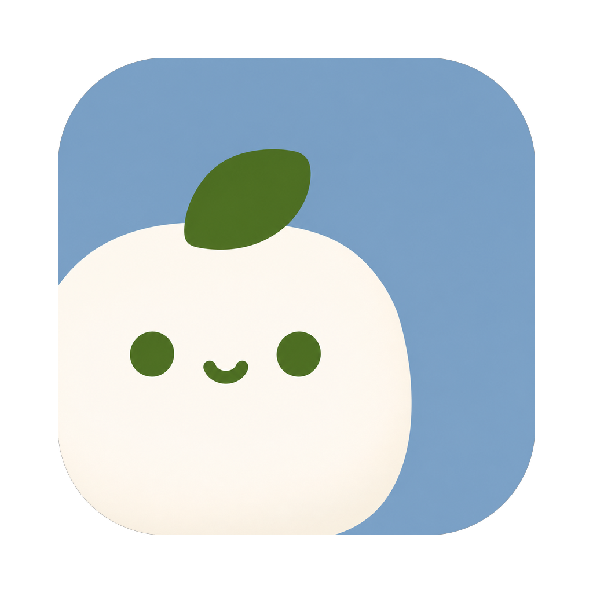

<div align="center">



# Mugi

Upscale photos to 4K on your Mac. Everything runs locally on the GPU, so your photos never leave your machine.

[](https://github.com/absolutepraya/mugi-upscale/actions)


[](LICENSE)

[Features](#features) • [Install](#install) • [Use the app](#use-the-app) • [Command line](#command-line) • [Models](#models) • [Build a DMG](#build-a-dmg)

</div>

Mugi is a native SwiftUI app and a command line tool for enlarging photos with the DRCT-L and HAT-L super-resolution models. It runs [Spandrel](https://github.com/chaiNNer-org/spandrel) and PyTorch on Apple Silicon through Metal. After setup, nothing needs the network.

## Features

- **Private and offline.** Models and Python are local, and the DMG bundles both.
- **Two models.** DRCT-L for clean photographs and HAT-L for compressed or soft ones.
- **Compare models.** View both results side by side before you save one.
- **Inspect at 1:1.** Pan and zoom both panes together to check fine detail.
- **Your format.** Exports 8-bit sRGB PNG by default, or JPEG, TIFF, or HEIC, with ICC profiles and EXIF orientation handled for you.
- **Auto-save.** Optionally save every result to a folder you choose as soon as it is ready.
- **Wide input support.** Accepts PNG, JPEG, WebP, and TIFF.

## Install

You'll need an Apple Silicon Mac with macOS 14 or newer.

### From a DMG

1. Download the current DMG from [GitHub Releases](https://github.com/absolutepraya/mugi-upscale/releases).
2. Open it and drag **Mugi.app** into **Applications**.

> [!IMPORTANT]
> The repository is private, so downloading a release needs a GitHub account with access. The app uses ad-hoc signing. If macOS blocks it, follow the [installation guide](packaging/INSTALL.md), which is also inside the disk image.

### From source

You'll also need Swift 6 with a macOS SDK from Xcode or the Command Line Tools (`xcode-select --install`), and [`uv`](https://docs.astral.sh/uv/getting-started/installation/).

```sh
git clone https://github.com/absolutepraya/mugi-upscale.git
cd mugi-upscale
./setup.sh
./build-app.sh
open build/Mugi.app
```

Setup creates a local Python environment and downloads and verifies both model files (about 390 MiB in total).

> [!NOTE]
> Keep the built app in the repository's `build/` directory so it can find the environment and model weights. Rebuild with `./build-app.sh` after editing the Swift source.

## Use the app

1. Click **Add Photo** (⌘O) or drop a photo onto the window.
2. Select a model.
3. Click **Upscale**. The bar shows completed tiles, and the timer includes model loading and PNG preparation.
4. When the second preview appears, click **Save…**, or turn on auto-save in Settings.

The icon buttons at the top right switch between System, Light, and Dark appearance and open **Settings** (⌘,). Settings has three tabs:

- **General:** appearance, default model, output size (3,840, 4,096, or 7,680 px on the long edge), tile size, and haptic feedback.
- **Output:** auto-save, the default output folder, and the image format, with a quality slider for JPEG and HEIC.
- **About:** credits, source code, and model licenses.

Use **1:1** to inspect the output at one image pixel per display pixel. Drag either pane to pan both together. The original scales to the same framing as the output. **Fit** returns to the whole image.

Click **Compare Models** to view DRCT-L and HAT-L side by side. Mugi runs any missing model first and keeps both results for the current photo. Use **Show Original** to switch back, or **Save…** to choose which output to export.

## Command line

The same engine is available from the terminal. Run these from the repository with `uv` installed.

```sh
# One photo
uv run --locked upscale.py "/path/to/landscape.png" -o output/landscape-4k.png

# A whole folder
uv run --locked upscale.py input -o output

# The second model
uv run --locked upscale.py "/path/to/landscape.png" --model hat -o output/landscape-hat-4k.png
```

| Option | Default | What it does |
|---|---|---|
| `--model` | `drct` | `drct` for clean photographs, `hat` for photos with JPEG compression and blur |
| `--long-edge` | `3840` | Target size of the long edge in pixels. A 16:9 input becomes 3840 × 2160. Use `4096` for a 4,096-pixel long edge |
| `--tile` | `256` | Input tile size: `128`, `192`, `256`, `320`, or `384`. Use `192` or `128` if Metal runs out of memory |
| `--device` | `mps` | `mps` runs on the GPU through Metal. Use `cpu` if Metal is unavailable |

Other aspect ratios keep their framing. The CLI refuses to overwrite an existing output path, so use a new filename or directory to rerun. Use `uv run --locked --offline` to run without network access after setup.

> [!TIP]
> Both models estimate detail rather than recover it. Compare foliage, fog, fine edges, and repeating textures at 100% zoom to choose the better fit for a photo.

## How it works

Mugi runs the model in full precision on overlapping tiles and crossfades the seams. Images that already meet the requested size are passed through, or downsampled to fit. Smaller inputs get a native 4× model pass followed by a Lanczos resize to the requested dimensions. If the input is under 960 pixels on its long edge, that final resize enlarges beyond the native 4× result.

Run one job at a time so the GPU has room for the tiles.

## Models

Setup downloads these weights from Philip Hofmann's model repositories under [CC BY 4.0](https://creativecommons.org/licenses/by/4.0/):

- DRCT-L: [4xNomos2_hq_drct-l](https://huggingface.co/Phips/4xNomos2_hq_drct-l)
- HAT-L: [4xNomos8kSCHAT-L](https://huggingface.co/Phips/4xNomos8kSCHAT-L)

The application and CLI source are under the [MIT License](LICENSE).

## Build a DMG

On an Apple Silicon Mac with `uv` and the Apple developer tools:

```sh
./packaging/build-dmg.sh 0.1.0
```

The DMG appears under `build/dist/`. It contains the app, Python, its locked dependencies, and both verified model files, so an installed copy runs offline.

The [CI workflow](.github/workflows/ci.yml) checks and builds the app on pull requests and pushes to `main`. To publish a release, start the [macOS Release workflow](.github/workflows/macos-release.yml) from `main` with a new version such as `0.1.0`. It builds the DMG and publishes it to GitHub Releases with a SHA-256 checksum and the install instructions.
